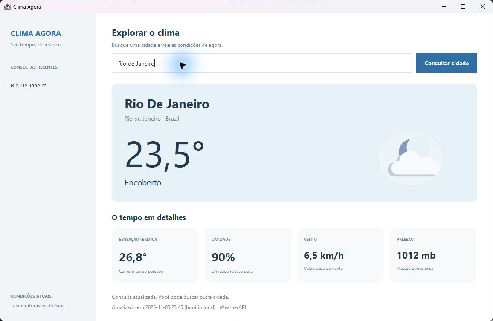

# Sistema de Informações Climáticas em Tempo Real

Aplicação de terminal em Java que consulta as condições atuais de uma cidade na WeatherAPI. Exibe temperatura, sensação térmica, condição do tempo, umidade, vento, pressão e horário da atualização.

## Tecnologias

- Java 11 ou superior, com java.net.http.HttpClient.
- Biblioteca org.json (JAR incluído).
- WeatherAPI via HTTPS.

## Executar no Windows (PowerShell)

~~~powershell
git clone https://github.com/Jaumbitin/sistema-de-informacoes-climaticas-em-tempo-real-atualizado.git
cd sistema-de-informacoes-climaticas-em-tempo-real-atualizado
javac -encoding UTF-8 -cp json-20230618.jar ProjetoSistemaDeInformacoesClimaticasEmTempoReal.java
~~~

Obtenha sua chave em https://www.weatherapi.com/ e forneça-a apenas na sessão local. O comando solicita a chave sem mostrá-la na tela nem gravá-la no histórico:

~~~powershell
$chaveClima = Read-Host 'Chave WeatherAPI' -AsSecureString
$env:WEATHER_API_KEY = [System.Net.NetworkCredential]::new('', $chaveClima).Password
java -Dfile.encoding=UTF-8 -cp '.;json-20230618.jar' ProjetoSistemaDeInformacoesClimaticasEmTempoReal
Remove-Item Env:WEATHER_API_KEY
~~~

Digite a cidade quando solicitado. Nenhum arquivo .env é carregado automaticamente.

## Segurança

A aplicação lê exclusivamente a variável WEATHER_API_KEY. Não coloque chaves no código, em capturas, em commits ou no README. Arquivos locais como api-key.txt e .env são ignorados pelo Git.

Uma chave esteve em um arquivo versionado. Remover o arquivo da versão atual não apaga histórico, clones ou cópias: revogue ou regenere a chave no painel da WeatherAPI e use a nova apenas localmente. A alteração do código não revoga a credencial antiga.

## Tratamento de falhas

A aplicação informa chave ausente, cidade vazia, localização não encontrada e falha na consulta. Requisições possuem limites de tempo e mensagens de erro não exibem a URL autenticada.

Desenvolvido por João Victor R.

## Interface gráfica: Clima Agora

Com a variável WEATHER_API_KEY configurada na sessão:

~~~powershell
javac -encoding UTF-8 -cp json-20230618.jar ProjetoSistemaDeInformacoesClimaticasEmTempoReal.java ClimaDesktop.java
java -cp '.;json-20230618.jar' ClimaDesktop
~~~

A janela permite consultar cidades e rever as últimas cinco buscas da sessão. A consulta ocorre em segundo plano. As condições atuais incluem temperatura, sensação térmica, umidade, vento, pressão e horário local da atualização. A chave continua sendo lida apenas da variável de ambiente.

Detalhes visuais: [decisões de interface](docs/DESIGN.md).
